<!-- _class: lead -->
<!-- _paginate: false -->
<!-- _header: "" -->

# 点検実施画面 表示パターン

安全セーフティ ／ 現場スマホ用の点検実施画面

**本番で実装する仕様**をまとめたもの

---

## この資料について

- 対象画面：**点検実施画面**（現場のスマホで開く画面）
- 本資料は**本番で実装する仕様**を示す。掲載している画面は仕様確認用のモックのキャプチャ
- 仕様の詳細は [01-点検実施画面.md](./01-点検実施画面.md) を参照

### 前提となる動線

```
資機材ごとに発行されたQRコード  →  読み取り  →  点検実施画面
```

- QRコードは**機械・仮設などの資機材ごとに発行**する
- 読み取った時点で**対象の資機材が1つに決まる**
- そのため、**機械／仮設を切り替えるタブは本番には存在しない**

---

## 画面は対象によって2種類

| 対象 | 点検の種類 | 到達方法 |
|---|---|---|
| **機械**（例：ELV-2） | 始業前点検（当日）／月例点検（当月） | 機械に貼付したQRコード |
| **仮設・その他**（例：わくぐみあしば） | 始業前点検（当日）／組立後等点検 | 仮設に貼付したQRコード |

- どちらの画面も**同じレイアウト**（基本情報カード → 点検状態 → 操作ボタン）
- 表示される点検の種類とボタンの構成だけが異なる

### 点検表の紐づけ

- **点検表は資機材（QRコード）に紐づけて設定する**
- 片方だけ紐づく場合も、**何も紐づいていない場合もある**
- 紐づいていない点検は**帯を表示しない**
- **どちらも紐づいていないとき**だけ、設定を促す案内を出す（後述）

---

## 機械の画面 ｜ 状態の組み合わせ

**始業前点検（当日）** と **月例点検（当月）** の2つの状態で決まる（2×2＝4パターン）。

| 状態 | 表示 |
|---|---|
| 未 | 淡いピンクの帯＋⚠️アイコン、文字はピンク |
| 済 | 淡い青の帯＋✓アイコン、文字は青 |

- **始業前点検開始** は常に主要アクション（ティール塗り）
- **非稼働登録** は始業前点検が済のときだけ非活性
- **点検元請確認** は点検記録が1件も無いとき非活性

---

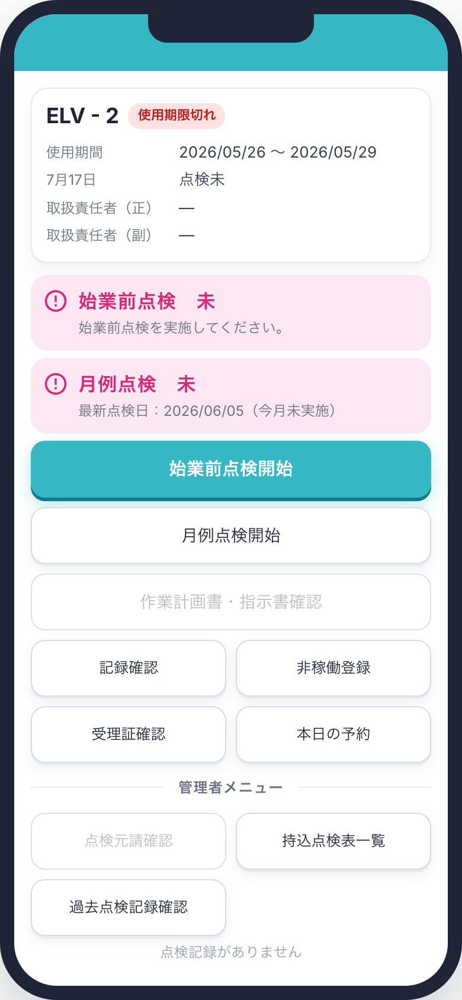

## 機械① 始業前：未／月例：未

- 帯は**2つともピンク（未）**
- 当日も当月も未実施の状態
- **非稼働登録：活性**（まだ点検していないため）
- **点検元請確認：非活性**＋「点検記録がありません」
  <span class="note">※ 始業前・月例とも記録が無いため</span>

---

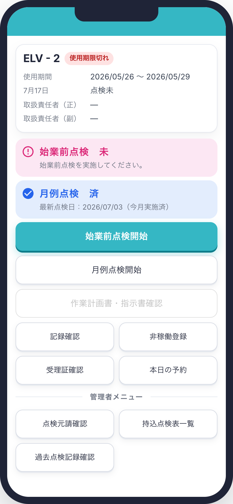

## 機械② 始業前：未／月例：済

- 始業前のみピンク（未）、月例は青（済）
- **最も多い想定パターン**（月例は済ませてあり、当日の点検がこれから）
- 月例点検の帯には**最新点検日と「今月実施済」**を表示
- 非稼働登録：活性

---

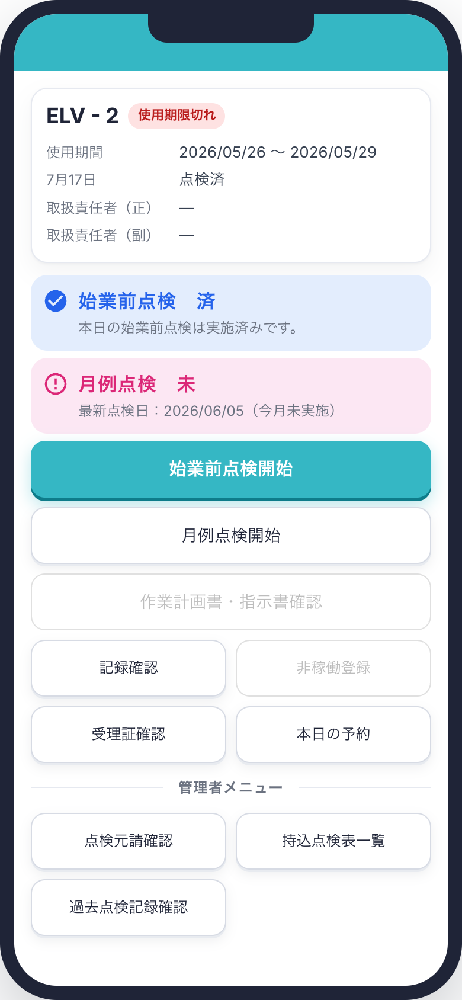

## 機械③ 始業前：済／月例：未

- 始業前は青（済）、月例はピンク（未）
- 月例点検の帯には**最新点検日と「今月未実施」**を表示
- **非稼働登録：非活性**（当日の点検が済んでいるため）

---

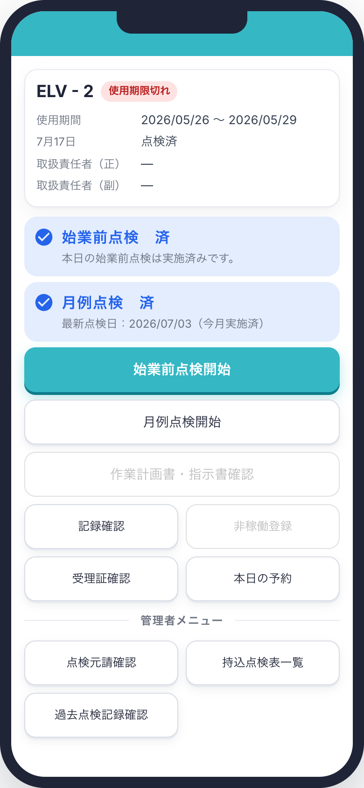

## 機械④ 始業前：済／月例：済

- 帯は**2つとも青（済）**
- 当日・当月とも対応済みの状態
- 非稼働登録：非活性
- ボタンの配置・活性状態は③と同じ

---

## 機械 ｜ 点検表が紐づいていない場合

紐づいていない点検は**帯そのものを出さない**。

- 案内は**どちらの点検表も紐づいていないとき**だけ表示する
  > 「点検用QRコード印刷」で点検表を設定してください
- 片方だけ紐づいている場合は、**案内を出さず**その点検の帯だけを表示する
- 紐づいていない点検の**開始ボタンは非活性**にする（点検表が無いと実施できないため）

---

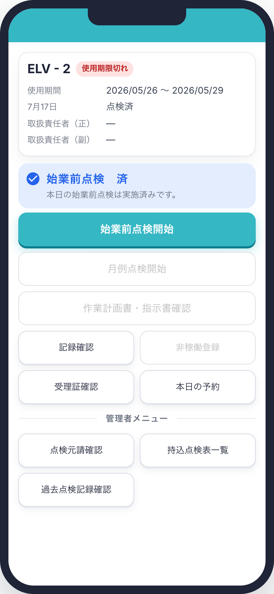

## 機械⑤ 始業前のみ紐づけ

- 始業前点検の帯のみ表示
- **月例点検の帯は出さない**
- **案内は出さない**（片方は紐づいているため）
- **月例点検開始：非活性**

---

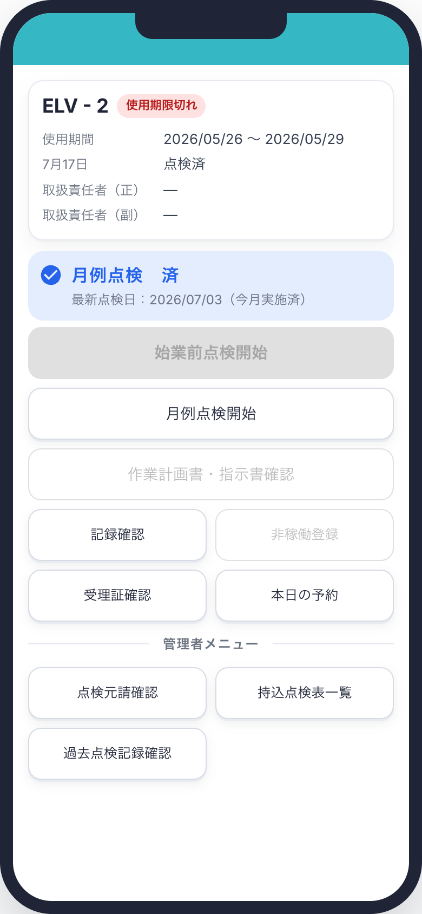

## 機械⑥ 月例のみ紐づけ

- 月例点検の帯のみ表示
- **始業前点検の帯は出さない**
- **案内は出さない**（片方は紐づいているため）
- **始業前点検開始：非活性**（主要アクションだが押せない）

---

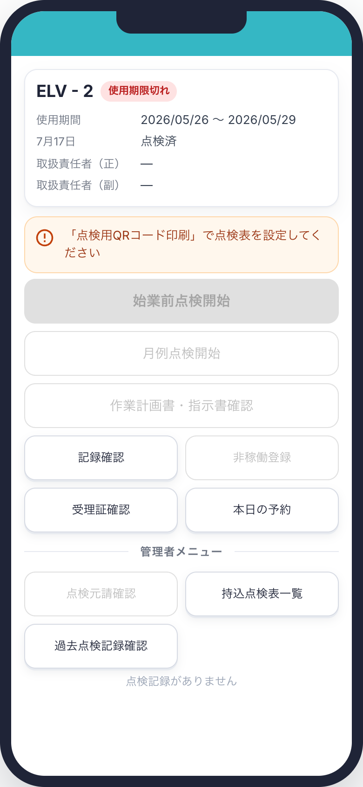

## 機械⑦ どちらも紐づいていない

- **帯は1つも表示しない**
- **このときだけ案内を表示**
- **始業前点検開始・月例点検開始とも非活性**
- 点検元請確認も非活性（記録が存在しないため）

---

## 仮設・その他の画面 ｜ 点検の数え方

### 1回の点検 ＝ 実施者1名 ＋ 事由1つ

- 組立後等点検は、**1回の点検で選べる実施事由は1つだけ**
- **実施者も1名のみ**。実施者と事由は**必ずセット**
- **QRコードを読み直せば何回でも点検できる**
  → 実施するたびに実施者と事由が1組ずつ増える

| 区分 | 判定 | 表示 |
|---|---|---|
| 始業前点検 | 実施 **0回** | 赤帯で「未」 |
| 始業前点検 | 実施 **1回以上** | 実施者名を表示（**「済」とはしない**） |
| 組立後等点検 | 常に表示 | 実施者＋事由の組（0回なら空欄） |

<span class="note">「済」としない理由：同じ足場でも使用者ごとに点検が必要で、何名で済とするかは現場ごとに異なるため</span>

---

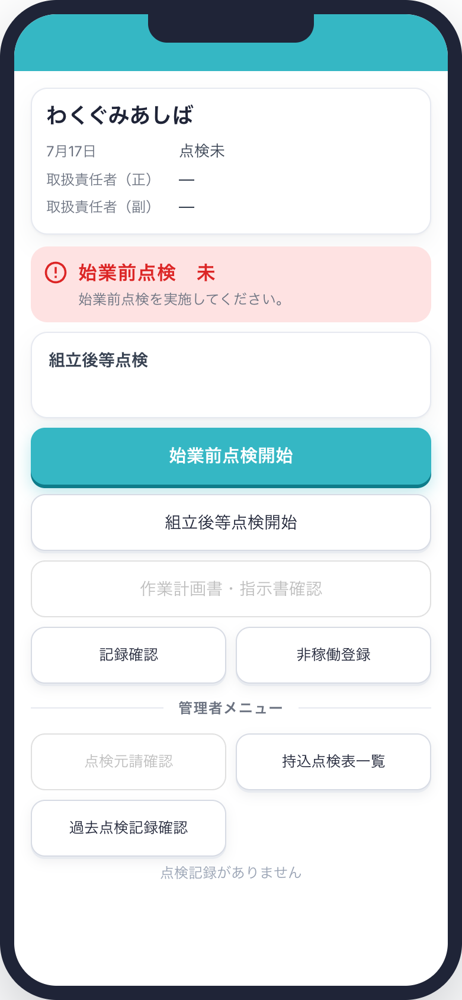

## 仮設① 点検 0回

- 始業前点検は**赤帯で「未」**
- 組立後等点検は**カードのみで中身は空欄**
- QRを読み取った直後の初期状態
- **点検元請確認：非活性**＋「点検記録がありません」

---

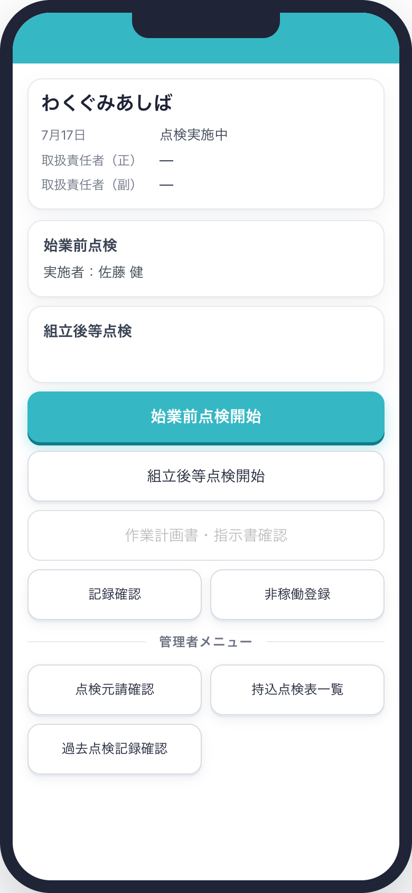

## 仮設② 始業前点検を1回実施

- 始業前点検が赤帯から**実施者名のカード**に変わる
- 「済」とは表示せず、**実施者名だけ**を出す
- 組立後等点検は空欄のまま
- 点検元請確認：**活性**（記録が1件できたため）

---

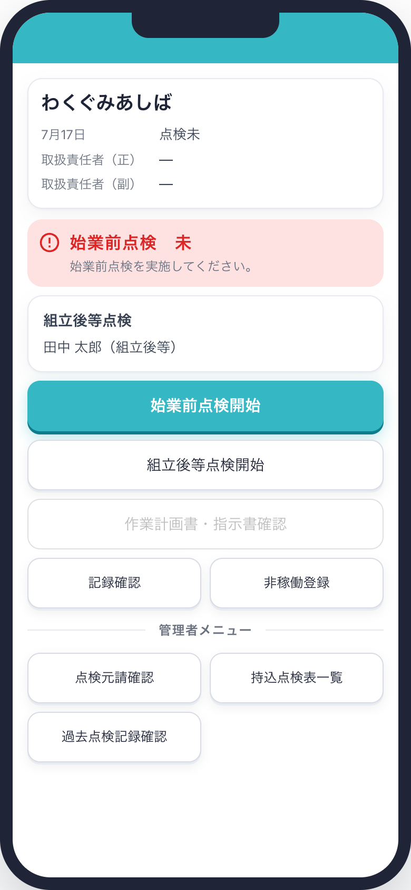

## 仮設③ 組立後等点検を1回実施

- 組立後等点検に**実施者1名＋事由1つ**を表示
- これが**1回の点検の最小単位**
- 始業前点検は未のまま（赤帯）

---

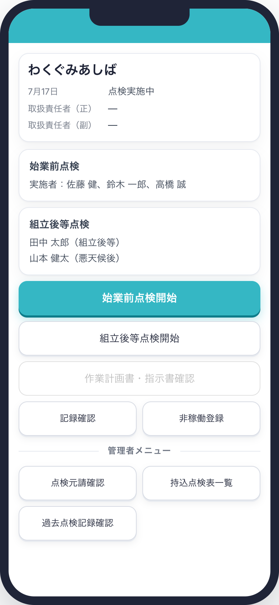

## 仮設④ 複数回実施（始業前3回／組立後等2回）

- 始業前点検を3回 → **実施者が3名**
- 組立後等点検を2回 → **実施者2名・事由2つ**
- 実施回数が増えるほど、実施者と事由が1組ずつ積み上がる

- 組立後等点検は **`実施者（事由）` の形式で1回1行**に並べる

---

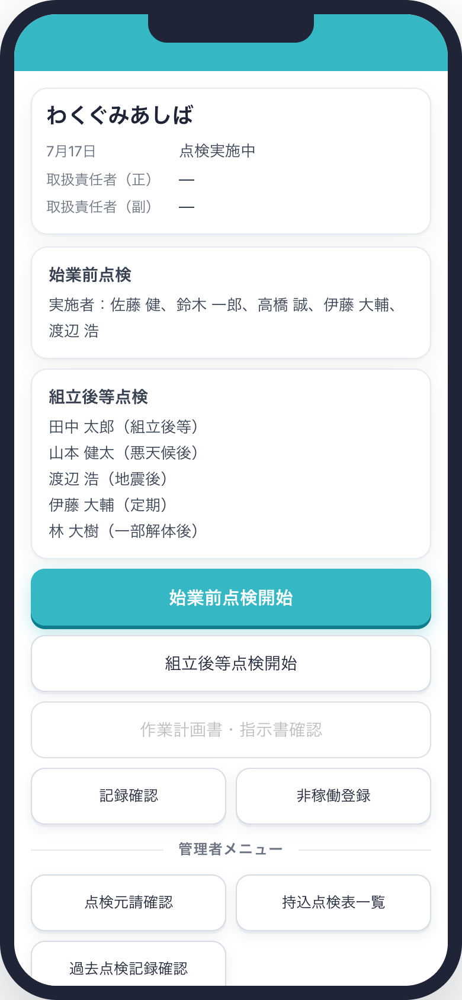

## 仮設⑤ 表示量が最大のケース（各5回）

- 始業前5回・組立後等5回を想定した**折り返しの確認用**
- 実施者が増えるとカードが複数行に折り返す
- この状態でも**スクロールなしで1画面に収まる**ことを確認

---

## 実施者と事由の表示

本番では **1回の点検 ＝ 実施者1名＋事由1つ**。複数回実施すると対応関係が生まれる。

| 回 | 実施者 | 事由 |
|---|---|---|
| 1回目 | 田中 太郎 | 組立後等 |
| 2回目 | 山本 健太 | 悪天候後 |

**表示は1行1回で組にして並べる。**

```
組立後等点検
田中 太郎（組立後等）
山本 健太（悪天候後）
```

- 始業前点検は事由を持たないため、`実施者：佐藤 健、鈴木 一郎` と連記する

---

## 仮設・その他 ｜ 点検表が紐づいていない場合

機械と同じく、紐づいていない点検は**帯・カードそのものを出さない**。
案内を出すのは**どちらも紐づいていないとき**だけ。

---

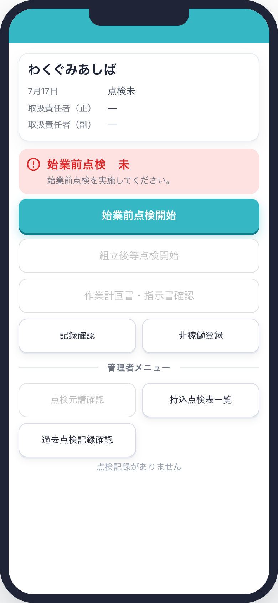

## 仮設⑥ 始業前のみ紐づけ

- 始業前点検のみ表示（未なので赤帯）
- **組立後等点検のカードは出さない**
- **案内は出さない**
- **組立後等点検開始：非活性**

---

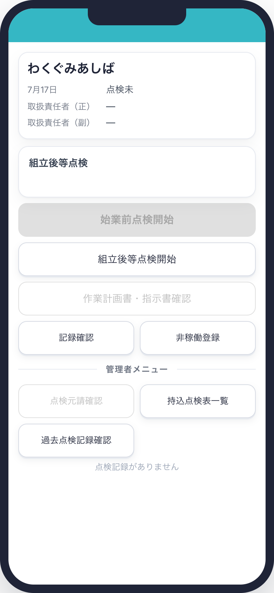

## 仮設⑦ 組立後等のみ紐づけ

- 組立後等点検のカードのみ表示
- **始業前点検の帯は出さない**
- **案内は出さない**
- **始業前点検開始：非活性**

---

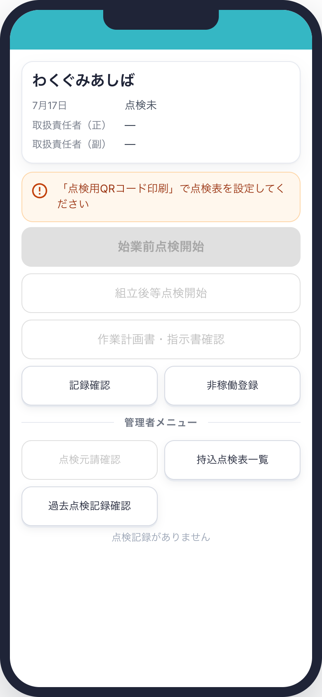

## 仮設⑧ どちらも紐づいていない

- **帯・カードとも表示しない**
- **このときだけ案内を表示**
- 両方の開始ボタンが非活性

---

## 共通の表示ルール

| 要素 | ルール |
|---|---|
| ヘッダー | 画面上部に水色（`#35b7c4`）の帯 |
| 基本情報カード | 名称を大きく表示。使用期限切れは赤バッジ |
| 主要アクション | **1画面に1つだけ**ティール塗り（始業前点検開始） |
| 操作ボタン | 高さ48px以上。ホバー効果は持たず、押下時に沈む |
| レイアウト | 全幅ボタン3つ＋2列ボタン。**スクロールなしで1画面**に収める |
| 管理者メニュー | 区切り線付きラベルで本体メニューと分ける |

---

## モック（デモ画面）との差異

本資料の画像は仕様確認用モックのキャプチャ。以下は**モック固有**であり、本番仕様ではない。

| モック | 本番 |
|---|---|
| 「機械」「仮設・その他」の**切替タブ**がある | **タブは無い**。QRコードで対象が決まる |
| 「表示切替（デモ）」のメニューで状態を操作できる | **存在しない**。状態はデータで決まる |
| 実施事由を**複数まとめて選べる** | **1回の点検につき1つ**。繰り返し実施で増える<br><span class="note">※モックでは「選んだ事由の数＝実施回数」として再現</span> |
| 実施回数を数値で増減できる | 実際にはQRを読み直して点検するたびに増える |
| 対象資機材は ELV-2／わくぐみあしば の固定サンプル | QRコードで特定した資機材 |
| スマホのモックアップ枠の中に表示 | 実機のブラウザで全画面表示 |
